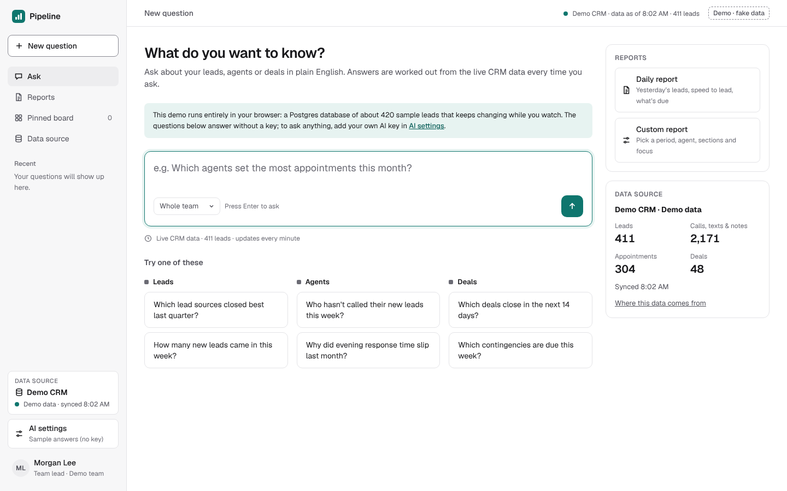
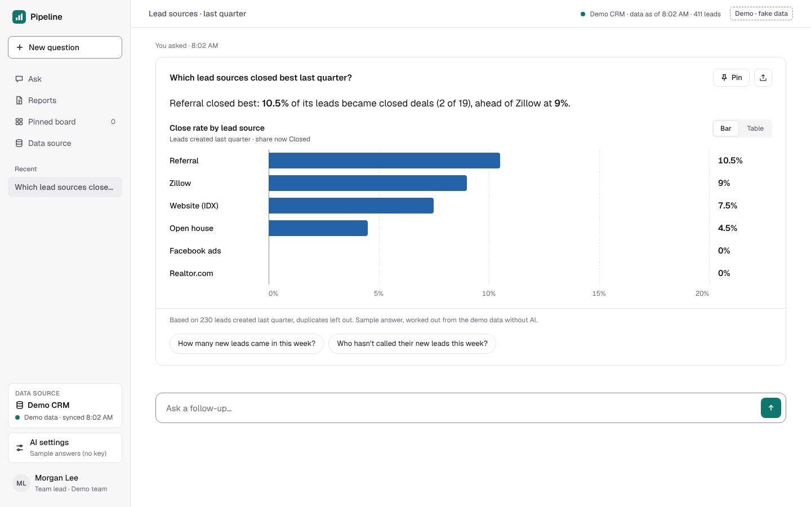
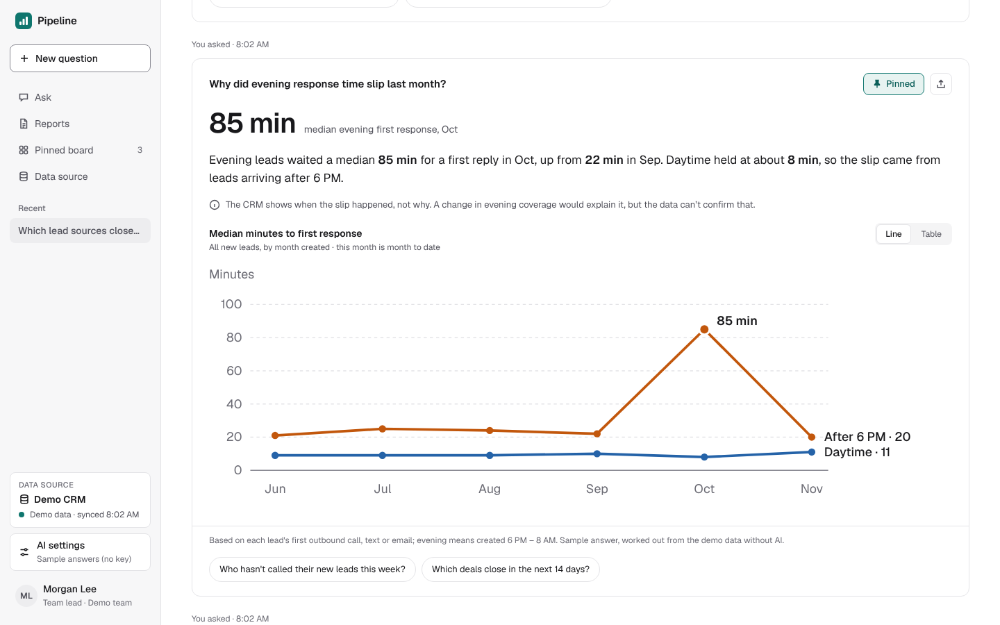
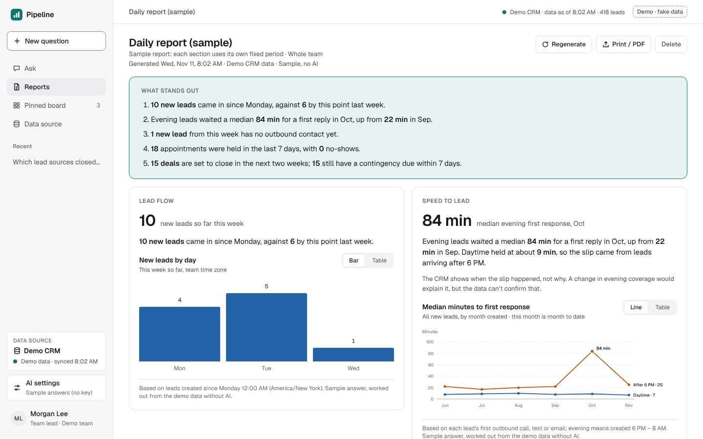
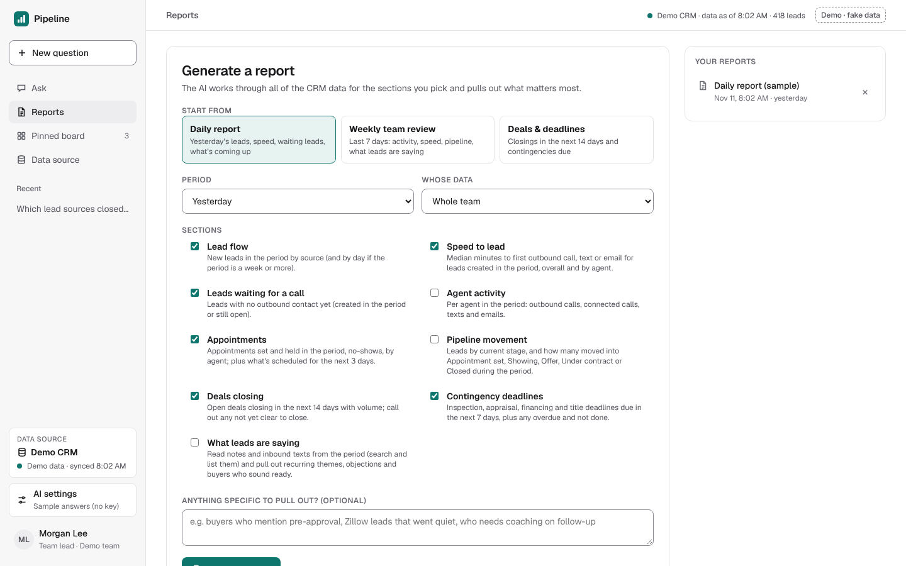
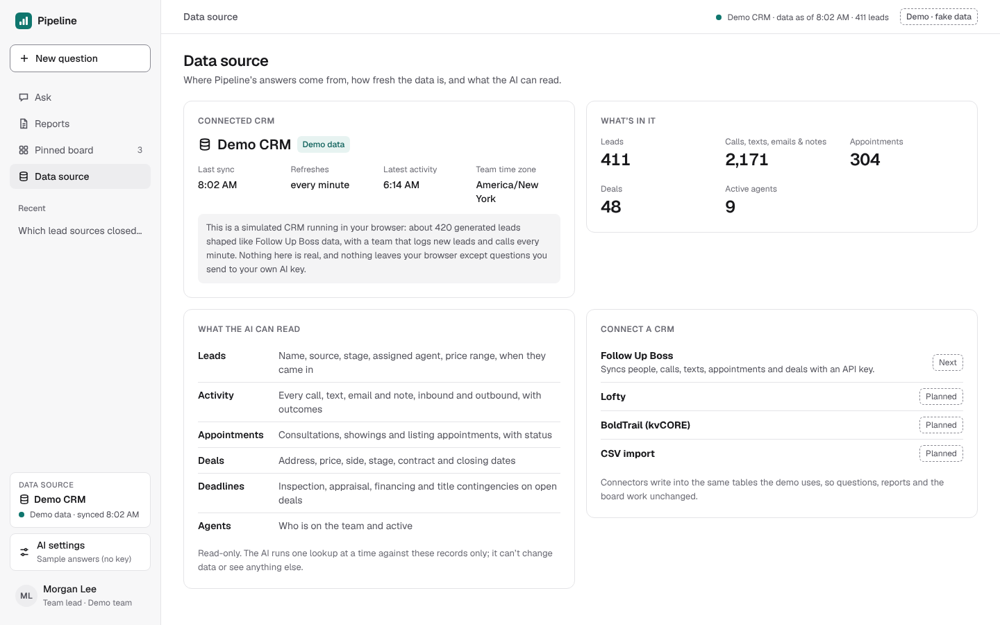
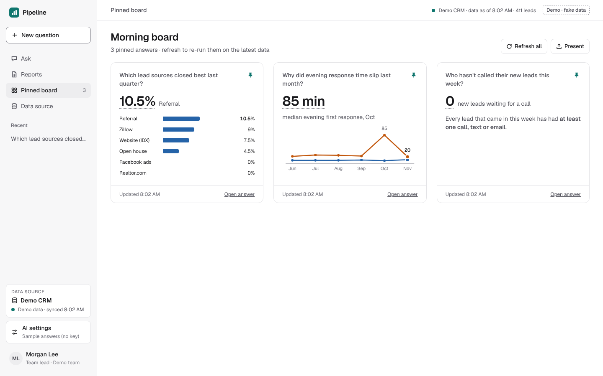
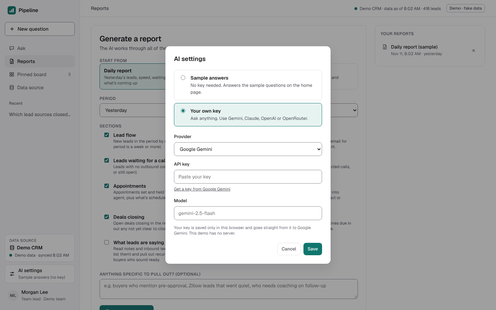
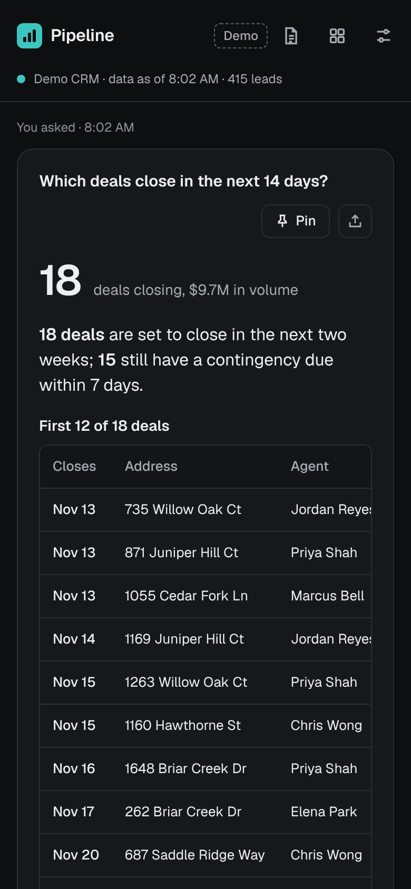

# Pipeline

AI analytics for real estate teams. Ask about your leads, agents or deals in plain English and get back a number, a chart and a one-line note on what it's based on, worked out from the live CRM data every time you ask.

**Live demo:** <https://asad-creats.github.io/analytics-chat/>

The demo runs entirely in your browser: a real Postgres database (PGlite) seeded with about 420 *generated* leads, 5 months of calls, texts and deals, and a simulated team that keeps logging new leads and calls every minute while you watch. Every name, address and phone number is fake. The six sample questions answer without a key. To ask anything else, add your own Gemini, Claude, OpenAI or OpenRouter key in **AI settings**; it goes straight from your browser to that provider. The first visit loads about 15 MB for the database engine.



| An answer | A trend, honest about cause |
|---|---|
|  |  |

| Daily report | Report builder |
|---|---|
|  |  |

| Data source | Pinned board |
|---|---|
|  |  |

| AI settings | Mobile (dark) |
|---|---|
|  |  |

## What it does

- **Ask in plain English.** "Which lead sources closed best last quarter?", "Who hasn't called their new leads this week?", "Which contingencies are due this week?"
- **Get a number, not an essay.** One or two sentences with the key figures, the right chart (bars to compare, columns for days, lines for trends) or a table of names, and what the answer is based on.
- **Sensible by design.** Answers come only from the data. Vague questions get "which number did you mean?"; out-of-scope ones get "the CRM can't answer that, but here's a related question it can". When the data shows *when* something happened but not *why*, it says so.
- **Follow-ups in context.** Keep asking in the same conversation ("break that down by agent").
- **Reports.** A one-click daily report, or a custom one: pick the period, one agent or the whole team, the sections (lead flow, speed to lead, waiting leads, agent activity, appointments, pipeline, deals closing, deadlines, what leads are saying) and anything specific to pull out ("buyers who mention pre-approval"). The AI works through the data and leads with what stands out. Print or save as PDF.
- **Knows where its data comes from.** The sidebar and the Data source page show which CRM is connected, whether it's live or demo data, when it last synced, how many records it holds and what the AI can read.
- **Morning board.** Pin the answers you check every day; Refresh re-runs them on today's data.

## How it works

```
Browser (React)  ──question──▶  Edge Function: pipeline-ask  ──▶  LLM (Gemini free tier, or your own key)
       ▲                               │   ▲                           │
       │                               │   └──── rows ◀── read-only SQL ┘   (tool calls, repeated as needed)
       └────── structured answer ◀─────┘
```

1. The question goes to the `pipeline-ask` Supabase Edge Function, with the last few turns of the conversation so follow-ups make sense.
2. The function gives the LLM a description of the CRM tables, today's facts about the data (lead count, agents, timezone, last refresh), and two tools:
   - `run_query`: one read-only `SELECT`, run inside the database as a role that can only read the CRM tables (no writes, no other schemas, 5 s limit, 200 rows).
   - `give_answer`: the final answer as structured data (summary, optional big number, chart, table, basis, follow-ups), checked before it's accepted.
3. The LLM looks things up, fixes its own query errors, and answers only from what it read. Unclear questions come back as "which did you mean?" and out-of-scope ones as "the data can't answer that".
4. The app draws the answer with its own components, so every answer matches the design.

This is retrieval over live data rather than a model that memorises anything: each question reads the database as it is at that moment, so answers change as the data does. Notes, texts and emails are full-text indexed, so the model can also search what people wrote.

### The data

`supabase/migrations/` creates a `pipeline` schema shaped like Follow Up Boss: agents, leads, activities (calls, texts, emails, notes), appointments, deals and deal deadlines. For the demo it's seeded with about 420 realistic, fake leads relative to today, and a scheduled job adds new leads, calls and stage changes every 15 minutes so the numbers move. A real CRM sync can write into the same tables later and replace the simulator.

### AI options

- **Free demo**: the server's Gemini key, capped at 10 questions per visitor per day and 60 per day for the whole site (both configurable). Visitors are counted by a salted hash of their IP; IPs aren't stored.
- **Your own key**: Gemini, Claude, OpenAI or OpenRouter, set in AI settings. The key stays in the visitor's browser and is sent with each question for that one answer; the server never stores or logs it.

## Setup

You need a Supabase project and the [Supabase CLI](https://supabase.com/docs/guides/cli).

1. **Database.** In the Supabase SQL editor, run in order:
   - `supabase/migrations/001_pipeline_schema.sql`
   - `supabase/migrations/002_pipeline_demo_data.sql` (seeds the demo data)
   - `supabase/migrations/003_pipeline_schedule.sql` (needs the `pg_cron` extension: Database → Extensions)
2. **Edge Function.**
   ```bash
   supabase link --project-ref <your-project-ref>
   ```
   ```bash
   supabase secrets set GEMINI_API_KEY=<key from aistudio.google.com> PIPELINE_QUOTA_SALT=<any long random string>
   ```
   ```bash
   supabase functions deploy pipeline-ask --no-verify-jwt
   ```
   Optional secrets: `PIPELINE_FREE_PER_VISITOR` (default 10), `PIPELINE_FREE_SITE_TOTAL` (default 60), `PIPELINE_FREE_MODEL` (default `gemini-2.5-flash`). Leave out `GEMINI_API_KEY` to run without a free tier (own keys only).
3. **Frontend.** Copy `.env.example` to `.env.local` and fill in the project URL and anon key (Project Settings → API). On Vercel, set the same two variables.

## Run it

```bash
npm install
```
```bash
npm run dev
```

`npm run build` type-checks and builds to `dist/`. Without the two `VITE_SUPABASE_*` variables the app still loads, and says live data isn't connected.

## Tests

The Edge Function tests run against a real Postgres with the migrations applied. They use a scripted model for the agent rules, and call Claude and Gemini only with invalid keys, to check error handling without spending credit.

```bash
PIPELINE_TEST_DB=postgres://postgres:<password>@localhost:5432/pipeline deno test -A --config supabase/functions/pipeline-ask/deno.json supabase/tests/
```

## GitHub Pages demo

`npm run build:pages` builds the self-contained demo into `docs/` (served at `/analytics-chat/`). In that build, `VITE_PIPELINE_MODE=browser` (from `.env.pages`) swaps the Supabase backend for one in the browser: PGlite runs the same migrations, the same agent code (`supabase/functions/pipeline-ask/agent.ts`) answers with the visitor's own key, and `src/api/demo/samples.ts` answers the sample questions without AI, from real queries on that data. Commit `docs/` and GitHub Pages serves it (Settings → Pages → Deploy from a branch → `main` / `/docs`).

## Portfolio build

The same browser demo also runs at `/pipeline/` on the portfolio site (`asad-creats/projects`, deployed on Vercel). To update it there:

```bash
npm run build:portfolio
```
```bash
rm -rf ../projects/public/pipeline && cp -r dist-portfolio ../projects/public/pipeline
```

Then commit and push `projects`; Vercel redeploys it from `master`.

## Code layout

- `supabase/migrations/`: schema, read-only query function, quota, demo data and simulator.
- `supabase/functions/pipeline-ask/`: the Edge Function. `agent.ts` (tool loop and guards), `prompt.ts` (data dictionary and rules), `providers.ts` (Gemini, Claude, OpenAI, OpenRouter), `answer.ts` (answer shape and validation), `index.ts` (HTTP, free tier, own keys).
- `src/api/pipeline.ts`: the frontend's client for the function.
- `src/api/demo/`: the GitHub Pages backend (PGlite + the shared agent) and the no-key sample answers.
- `src/state/`: AI settings, conversations and pins (kept in the browser), toasts.
- `src/components/`: the design's components. `AnswerView` turns an answer into cards, charts and states.
- `src/pages/`: Home, Conversation (`/c/:id`), Pinned board, and a States reference page.
- `src/styles/tokens.css`: colour, radius, font and motion tokens from the design's spec sheet, light and dark.
